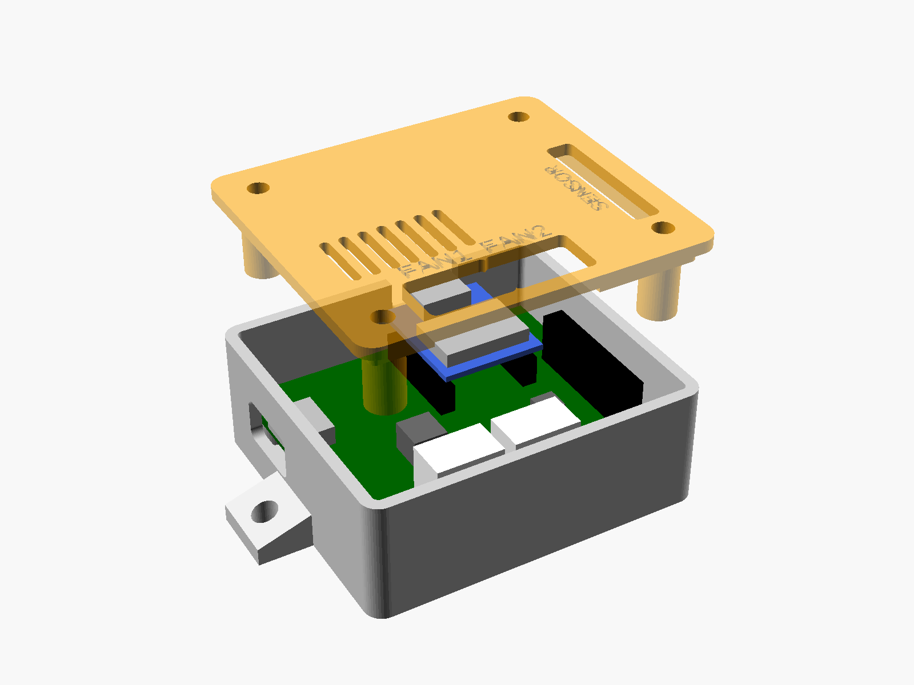

# Case

A two-part printed case for the fan controller board: a base the board screws into, and a lid
that clamps the board down. The fan plugs go in through openings in the lid.



| File | What it is |
|---|---|
| `cr-box-case-revB-xiao-base.stl` | Base, print as is |
| `cr-box-case-revB-xiao-lid.stl` | Lid, already flipped upside down for printing |
| `cr-box-case.scad` | OpenSCAD source; every dimension is a parameter at the top |

## Size

57 × 51 × 22.6 mm, or 75 mm wide including the two mounting ears.

## Printing

- PLA or PETG, 0.2 mm layers, 3 perimeters, 20 % infill.
- No supports needed. The base prints open side up; the lid prints top face down.

## Hardware

- 4 × M3 × 20 mm screws (pan or button head).
- Each screw passes through the lid and a pillar that presses on the board, then threads into a
  standoff in the base. The 2.6 mm pilot holes take the screw directly. For heat-set inserts, set
  `SCREW_PILOT = 4.0` and re-export the base.
- The ears take M4 screws or cable ties for mounting on the purifier.

## Openings

| Opening | Where |
|---|---|
| USB-C power | Left wall, lined up with the board's USB-C socket. 13 × 7.5 mm, so most cable plugs fit. |
| XIAO USB-C | Notch in the top of the back wall, for flashing the XIAO the first time. |
| Fan plugs | One opening in the lid over both fan headers, labelled FAN1 and FAN2. |
| Sensor cables | Slot in the lid over the I2C and UART headers. Set `SENSOR_SLOT = false` to close it. |
| Vents | Seven slots in the lid over the 12 V converter. |

## Assembly

1. Put the board into the base, USB-C socket towards the left-wall opening.
2. Plug in the XIAO.
3. Fit the lid and screw down all four corners. Tighten gently; the pillars clamp the board.
4. Plug the fans in through the lid.

## Assumptions

The model was checked for collisions against simplified blocks of the tall parts, not real 3D
models, so check these on the real board before printing a final version:

- **XIAO height.** The model assumes 3.5 mm low-profile sockets (`SOCKET_H`) and short male pin
  headers on the XIAO with a 2.5 mm plastic spacer (`HEADER_SPACER`). That puts the XIAO's USB-C
  port about 8.6 mm above the board, which sets the notch in the back wall. Measure your assembled
  board and change those two values if they differ. Space under the lid is 12 mm (`CLEAR`).
- **USB plug sizes.** A USB-C cable whose plug body is larger than 13 × 7.5 mm will not seat fully
  in the power socket. Widen `J1_W` and `J1_H` if yours doesn't.
- **Fan header height.** Molex 47053-1000 headers are about 11.4 mm tall in the model, just under
  the lid. A taller header still fits, because the lid opening sits directly above it.

Change a parameter in `cr-box-case.scad`, then export again:

```sh
openscad -D 'VARIANT="xiao"' -D 'part="base"' -o cr-box-case-revB-xiao-base.stl cr-box-case.scad
openscad -D 'VARIANT="xiao"' -D 'part="lid"'  -o cr-box-case-revB-xiao-lid.stl  cr-box-case.scad
openscad -D 'VARIANT="xiao"' -D 'part="collide"' -o check.stl cr-box-case.scad   # empty result = nothing collides
```
