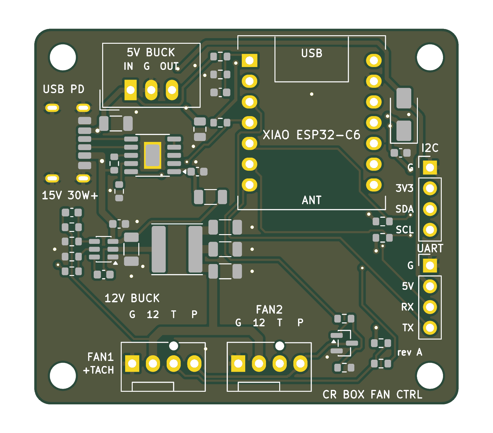

# CR Box PWM fan controller

A 52 × 46 mm, 2-layer controller board for a Corsi-Rosenthal air purifier built from 12 V 4-pin PWM
PC fans. It is powered from a USB-C PD charger and controlled from Home Assistant through ESPHome
on a Seeed XIAO ESP32-C6.



**Status: designed and rule-checked, not yet built.** No prototype exists. Treat the first order as
a prototype run and read [Before you order](#before-you-order).

## What it does

- Takes power from any USB-C PD charger of 30 W or more. A CH224A requests 15 V, which every PD
  charger above 27 W must offer. (12 V is no longer a standard PD voltage, so the board does not
  depend on it.)
- Steps 15 V down to a regulated 12 V fan rail with a TPS54302 buck converter, good for about
  1.5 A of fans (the limit is inductor L1, rated 2.2 A / 2.7 A).
- Switches the fan rail fully off through the converter's enable pin, so "off" in Home Assistant
  stops fans that would otherwise idle at 0 % PWM.
- Drives the 25 kHz PWM line open-collector, as the 4-pin fan spec asks, and reads RPM from FAN1.
- Reports the charger voltage and whether PD negotiation succeeded.
- Breaks out I2C (3.3 V) and UART (5 V) headers for an air-quality sensor.

Arctic P14 PWM PST fans daisy-chain, so the whole chain plugs into FAN1. FAN2 is a second header on
the same rail without tach.

## Files

| Path | What it is |
|---|---|
| `cr-box-fan-controller.kicad_pro` / `.kicad_sch` / `.kicad_pcb` | KiCad 9 project |
| `docs/schematic.pdf` | Schematic |
| `fab/cr-box-fan-controller-gerbers.zip` | Gerbers and drill files for JLCPCB |
| `fab/cr-box-fan-controller-bom-jlcpcb.csv` | BOM for JLCPCB assembly (SMT parts) |
| `fab/cr-box-fan-controller-cpl-jlcpcb.csv` | Placement file for JLCPCB assembly |
| `fab/cr-box-fan-controller-bom-hand-solder.csv` | Parts you buy and solder yourself |
| `esphome/cr-box.yaml` | ESPHome firmware config |
| `scripts/` | Generators: the board, schematic and fab files are built from `scripts/design.py` |

## Ordering from JLCPCB

1. Upload `fab/cr-box-fan-controller-gerbers.zip`. Defaults are fine: 2 layers, 1.6 mm, 1 oz copper.
2. Turn on **PCB Assembly**, top side, and upload the BOM and CPL files from `fab/`.
3. In the part-matching step, confirm every match.
4. In the placement preview, check the orientation of **U1, U2, U4, Q3, D1 and J1** against
   `docs/board-assembly.png` and the pin-1 marks, and rotate any that are wrong.

U2, the 5 V regulator module (K7805-500R3, C2992390), is through-hole and is in the JLCPCB BOM, so
JLCPCB fits it; this may add a small hand-soldering fee. Its pin 1 (input) is the square pad nearest
the USB-C connector. To fit it yourself instead, delete its line from the BOM and CPL files. Any
5 V switching module in the 3-pin 7805 footprint works; a linear 7805 will overheat.

### Parts you solder yourself

| Ref | Part |
|---|---|
| U3 | Seeed XIAO ESP32-C6, on two 1×7 pin headers (or sockets) |
| J2, J3 | 4-pin PWM fan headers (Molex 47053-1000 or a generic "KF2510 4-pin fan header") |
| J4, J5 | 1×4 2.54 mm pin headers, only if you add sensors |

## Before you order

These are the things I could not verify from here:

- **Fan current above 1.5 A** needs a 15 µH inductor with a higher current rating than the
  FNR6045S150MT in the BOM. Add up the rated current of your fans first.
- **Capacitor, diode and transistor part numbers** (C1–C13, D1, Q3) are JLCPCB basic parts quoted
  from memory. The connector, both ICs and all resistors were looked up. Confirm each line in
  JLCPCB's matching step; any equivalent with the same value, package and voltage rating works.
- **Placement rotations** follow the usual KiCad-to-JLCPCB corrections but were not checked against
  JLCPCB's viewer.
- **CH224A stock was a few thousand** when checked. The CH224K fits the same footprint: change R1
  to 1 kΩ (1206) and R16 to 10 kΩ.
- **Behaviour with a charger that has no 15 V** (most 20 W phone chargers) is not documented by the
  CH224A datasheet. The board cannot be damaged by a lower voltage, but the fans will run slow or
  not at all; the "Charger OK" sensor reports it.
- The 12 V converter layout follows the TI datasheet guidance but is untested. Check the fan rail
  with a multimeter before plugging fans in.

## Circuit summary

| Block | Parts | Notes |
|---|---|---|
| USB-C PD sink | J1, U1, R1, R16, R2, C1 | 56 kΩ on CFG1 selects 15 V. The two CC lines are interchangeable. |
| 12 V fan rail | U4, L1, C8–C13, R3, R4, C6 | 100 k / 5.1 k feedback gives 12.3 V. R5/R6 hold EN low until the XIAO drives it high. |
| 5 V rail | U2, C2, C3, D1 | D1 stops the board back-feeding a computer plugged into the XIAO's own USB port. |
| PWM and tach | Q3, R7–R10 | PWM is inverted in firmware. Tach is pulled up to 3.3 V. |
| Voltage sense | R11, R12, C7 | 15 V reads as about 1.96 V at the ADC. |

XIAO pin use is listed at the top of `esphome/cr-box.yaml`.

## Firmware

Flash `esphome/cr-box.yaml` over the XIAO's USB port the first time, then update over Wi-Fi. The
device appears in Home Assistant as a fan with a speed slider plus RPM, input voltage and two
diagnostic sensors. A PM2.5 automation can then set the speed.

The fan rail stays off while the XIAO boots or if it is not fitted.

## Checks that were run

- KiCad DRC on the PCB: 0 violations, 0 unconnected items (JLCPCB-compatible limits: 0.2 mm
  clearance, 0.25 mm minimum track, 0.3 mm minimum drill).
- The schematic netlist, the PCB pad nets and `scripts/design.py` match: 28 nets, 115 pins.
- Pin assignments for the CH224A, TPS54302 and XIAO ESP32-C6 were taken from their datasheets.

## Regenerating

Requires KiCad 9 with its Python module, numpy and scipy.

```sh
python3 scripts/gen_board.py place   # footprints, outline, zones
python3 scripts/route.py             # tracks, vias, silkscreen, zone fill
python3 scripts/drc.py               # KiCad DRC summary
python3 scripts/gen_sch.py           # schematic
python3 scripts/check_netlist.py     # schematic == PCB == design.py
python3 scripts/gen_fab.py           # Gerbers, BOM, CPL, schematic PDF
```

The board can also be edited directly in KiCad; the scripts are only needed to rebuild from
`design.py`.
