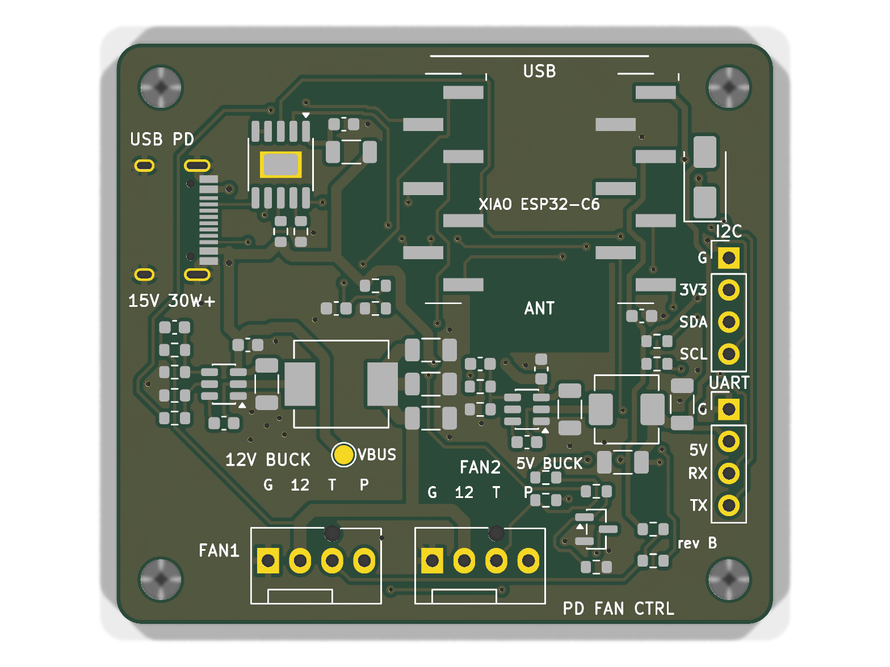

# ESPHome fan controller for a Corsi-Rosenthal box

A small board that runs 12 V PWM PC fans from a USB-C PD charger and puts them in Home Assistant
through ESPHome on a Seeed XIAO ESP32-C6. It is sized for a Corsi-Rosenthal air purifier (140 mm
fans such as the Arctic P14 PWM PST), but works for any 4-pin PWM fans.



- Requests 15 V from any USB-C PD charger of 30 W or more and makes a regulated 12 V fan rail.
- Switches the fan rail fully off, so "off" in Home Assistant stops fans that idle at 0 % PWM.
- 25 kHz PWM, RPM from both fan headers, input voltage, charger protocol and available current.
- I2C and UART headers for an air-quality sensor (3.3 V logic).
- Wi-Fi, Thread or Zigbee firmware builds, a KiCad 9 project, JLCPCB order files and a
  3D-printable case.

The board is rev B: the XIAO plugs into two surface-mount sockets and everything else is
surface-mount, so JLCPCB can assemble it with Economic PCBA. It is 52 × 46 mm, 2-layer. Rev A (a
through-hole version with a 5 V module) was cancelled before it was built; it is in the git
history.

## Layout

```
pcb/         KiCad project, fab/ (Gerbers, BOM, CPL) and docs/ (schematic PDF, renders)
esphome/     firmware: one file per network, plus common/ shared by all three
case/        OpenSCAD case model and STL files
scripts/     generators for the board, schematic and order files
```

**Status: designed and rule-checked, not built.** Measure the 5 V and 12 V rails on the first board
before connecting fans or plugging in the XIAO (see [the first-board checks](#things-to-check-on-the-first-board)). The board passes KiCad DRC with 0 violations and
0 unconnected items, and the schematic, PCB and `design.py` netlists match (33 nets / 142 pins).

A version with an ESP32-C6-MINI-1 module soldered to the board was also designed and then set
aside, because JLCPCB only fits that module with Standard PCBA. Its design and generated files are
in the git history.

## Changes from rev A

- **5 V rail:** a second TPS54302 buck (100 k / 13 k feedback, 5.18 V) replaces the K7805
  through-hole module. Its EN pin is left open, so it is always on.
- **12 V inductor:** TMPA0605S-150MN-D (LCSC C305194; 15 µH, 4 A rated and saturation, 73 mΩ,
  7.3 × 6.6 mm) on JLCPCB's land pattern for it. It is in stock at JLCPCB, so no pre-order is needed.
  The inductor would allow about 7 fans, but the TPS54302 then dissipates
  roughly 0.6–0.7 W in a SOT-23-6, so **treat 5 fans as the limit** until a built board has been
  checked for temperature at full load.
- **5 V inductor:** FXL0518-100-M (10 µH, 2.5 A continuous, 3 A saturation) instead of a 1.95 A part,
  so a short on the 5 V header no longer saturates it before the converter's current limit trips.
- **CH224A on the I2C bus:** its CFG2/SCL and CFG3/SDA pins join the XIAO's I2C bus (the datasheet
  allows 3.3 V logic on them; the board's 4.7 k pull-ups serve both). The CH224A still requests
  15 V by itself through its 56 k resistor. The firmware reads which protocol was negotiated and how
  much current the charger offers ("Charger Max Current" / "Charger Max Power"), so you can see
  whether a charger is big enough for your fans. The CH224A uses I2C address 0x22 or 0x23 (the
  datasheet gives both); don't put a sensor at those addresses on the header.
- **PWM driver base resistor R7** is 1 k (was 2.2 k), so Q3 stays saturated with 7 or more fans
  pulling the PWM line up at once.
- **Extra thermal vias** next to the 12 V converter's ground pin, spreading its heat into the
  bottom copper.
- **FAN2 tach** is read on its own pin (GPIO20) with its own 10 k pull-up and 10 k series resistor.
  FAN1's series resistor is also 10 k now, which protects the GPIO from fans that pull tach up to 12 V.
- **USB-C socket:** 16-pin TYPE-C-31-M-12 (its data pins are unused).
- **PD_PG pull-up** removed; the firmware uses the ESP32's internal pull-up.
- **Fan-header peg holes** are 1.3 mm (Molex recommends 1.25 mm; the KiCad library has 1.1 mm) so
  machine-inserted headers seat flat.
- **VBUS test pad (TP1)** next to the 12 V converter, for measuring the charger voltage.
- **Wider supply tracks:** the charger input (VBUS) is 0.8 mm wide (was 0.5 mm) for 7-fan loads, and
  no longer passes through a resistor pad on the way to the 5 V converter. The 12 V fan rail is 1 mm.
- **CH224A ground pad** has two vias straight down to the bottom ground plane (its exposed pad is
  its only ground pin).
- **CH224A DP/DM** are shorted together at the chip and not connected to the USB-C socket, as the
  datasheet describes for PD-only use. This turns off the QC/BC 1.2 fallbacks, which could only
  offer 5–12 V anyway; the fans need the 15 V PD profile.
- **Ground plane:** signal tracks on the bottom layer cut from about 260 mm to 150 mm. Estimated ground
  resistance from the USB-C socket and the 12 V output capacitors to the 12 V converter is now
  0.5–0.7 mΩ (a solid plane would be about 0.4 mΩ).

### Things to check on the first board

- **CH224A VBUS pin (R16):** the datasheet's reference circuit ties it straight to VBUS (as here,
  through R16 = 0 Ω), while its pin table says the pin tolerates 3.8 V. If PD negotiation misbehaves
  or U1 runs hot, this is the first thing to look at.
- **12 V converter temperature** with all fans at 100 %.
- **CH224A I2C:** check the boot log's I2C scan finds it at 0x22 or 0x23, and that "Charger Max
  Current" matches the charger's label. If the CH224A misbehaves with the bus connected, the
  sensors can be removed from the firmware, since it requests 15 V from its resistor with no I2C
  traffic needed.
- **Wi-Fi signal** with the XIAO in its sockets, compared with a bare XIAO (the 5 V converter is
  about 6 mm from the antenna end, 7.5 mm below it).
- Pull the XIAO **straight up** out of the SMD sockets; they're held only by their solder pads.

## Ordering

1. Upload `pcb/fab/*-gerbers.zip`. 2 layers, 1.6 mm, any solder-mask colour (green and blue were
   both quoted with Economic PCBA; colours other than green add about 2 days to the build time),
   HASL with or without lead. Don't pick OSP: that finish forces
   Standard PCBA.
2. PCB Assembly, **Economic**, top side. Upload a BOM and the CPL with the same suffix:
   - `*-jlcpcb.csv`: surface-mount parts only; you solder the fan headers.
   - `*-fanhdr-C19795120.csv`: JLCPCB also fits the fan headers (Molex 470533000). This was quoted
     as Economic PCBA with a small handling fee per header.
3. In the placement preview, check the orientation of U1, U4, U5, Q3, D1, J1, J6, J7 and the fan
   headers (locking ramp along the bottom board edge). L1 and L2 haven't been seen in JLCPCB's
   viewer yet; both are two-pad parts, so only their position matters.

## XIAO notes

- Pin use is the same as rev A, plus D9 (GPIO20) for FAN2 tach.
- Buy bare XIAOs and solder short (about 7.5 mm) 1×7 male headers to them, with the XIAO plugged
  into the board so the pins line up. The SMD sockets have closed bottoms, so long standard headers
  may not seat.
- The sockets are 5 mm tall; the case model assumes that.

## Firmware

There are three builds of the same firmware. Pick one and flash it over the XIAO's own USB
port the first time.

| File | Network | Home Assistant sees | Updates |
|---|---|---|---|
| `pd-fan-ctrl-wifi.yaml` | Wi-Fi, with a fallback hotspot | Fan entity with speed, all sensors | Over Wi-Fi |
| `pd-fan-ctrl-thread.yaml` | Thread (needs a border router) | Same as Wi-Fi | Over Thread |
| `pd-fan-ctrl-zigbee.yaml` | Zigbee router (ZHA or Zigbee2MQTT) | "Fan Power" switch and "Fan Speed" number, the sensors, no "Charger Protocol" | USB only |

- ESPHome can't run Wi-Fi and Thread at the same time, or Zigbee and Thread, so each build
  has one network. To change network, flash a different build: Wi-Fi to Thread works over the
  air; going to Zigbee, or back from Zigbee, needs the USB cable.
- **Thread** needs your network's dataset in `secrets.yaml` as `thread_tlv` (Home Assistant:
  Settings > Devices & services > Thread > Configure > the (i) on your network > Active dataset
  TLVs).
- **Zigbee** support in ESPHome is new and only exposes switches, numbers, sensors and binary
  sensors, so the fan is a switch plus a 0–100 % number and "Reset Filter Hours" is a switch
  that turns itself off. Zigbee2MQTT may show the device as generic endpoints.
- All three were compiled with ESPHome 2026.10.2 but none has run on hardware yet.

### Other XIAO boards

The board takes any XIAO ESP32 with the standard 14-pin layout. Pick yours in the `board:`
line near the top of the firmware file; the board files in `esphome/boards/` hold each chip's
settings and pin numbers.

| Board file | XIAO | Networks | Antenna |
|---|---|---|---|
| `xiao-esp32c6.yaml` (default) | ESP32-C6 | Wi-Fi, Thread, Zigbee | On the board |
| `xiao-esp32c5.yaml` | ESP32-C5 | Wi-Fi (2.4 and 5 GHz), Thread, Zigbee | External, U.FL |
| `xiao-esp32c3.yaml` | ESP32-C3 | Wi-Fi | External, U.FL |
| `xiao-esp32s3.yaml` | ESP32-S3 | Wi-Fi | External, U.FL |
| `xiao-esp32s3-plus.yaml` | ESP32-S3 Plus | Wi-Fi | External, U.FL |

- Boards with an external antenna come with a flexible one; stick it inside the case lid.
- ESPHome warns about "strapping pins" when compiling for the C3, C5 and S3. The board holds
  those pins at safe levels at power-on (see the notes in each board file), so the warnings are
  expected. On the C3, D0 is also pulled low by the voltage divider when no charger is
  connected; this only matters for the boot-button flashing mode, so check USB flashing on the
  first C3.
- The board was designed around the C6. The other boards' pins were checked against Seeed's pin
  maps and their firmware compiles, but none has been tried on the board.

## Files

| Path | What it is |
|---|---|
| `pcb/pd-fan-ctrl.kicad_pro`, `.kicad_sch`, `.kicad_pcb` | KiCad 9 project |
| `pcb/docs/` | Schematic PDF, 3D render, assembly drawing (with reference designators), case preview |
| `pcb/fab/` | Gerbers, JLCPCB BOM and CPL files, hand-solder list |
| `esphome/pd-fan-ctrl-wifi.yaml`, `-thread.yaml`, `-zigbee.yaml` | Firmware, one per network (see [Firmware](#firmware)) |
| `esphome/common/pd-fan-ctrl-core.yaml` | Fan control and sensors shared by all three |
| `esphome/boards/` | Chip settings and pin numbers for each XIAO |
| `case/` | OpenSCAD case model and STL files |
| `scripts/` | Generators |

## Regenerating

```sh
cd scripts
python3 gen_board.py place     # footprints, outline, zones
python3 route.py               # tracks, vias, silkscreen, pour, stitching
python3 drc.py                 # KiCad DRC summary
python3 gen_sch.py             # schematic
python3 check_netlist.py       # schematic == PCB == design.py
python3 gen_fab.py             # Gerbers, BOM, CPL, schematic PDF
```
